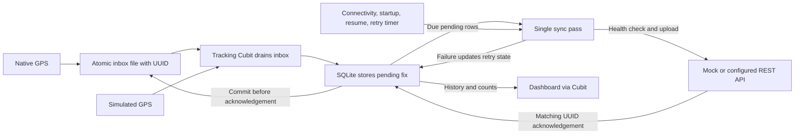

# Driver Tracking

Driver Tracking is a Flutter assessment app for Android and iOS. It records a route using native location services, saves fixes locally before upload, and synchronizes pending fixes when connectivity returns. An in-process mock REST API makes the demo runnable without a server or credentials.

## Assessment features

- Start and stop a real GPS session or use the **Simulated GPS** mode with a fixed coordinate sequence.
- View tracking and network status, the latest coordinates and timestamp, the latest 200 fixes, and counts across the full SQLite history.
- Record fixes offline, reopen the app with pending work intact, and reconcile with the mock API on reconnect.
- Simulate an outage or upload failure from **Testing controls** and retry exhausted records from the dashboard.

## Stack and architecture

Flutter and Dart provide the dashboard. `flutter_bloc` exposes Cubit state, `sqflite` stores fixes and mock receipts, `connectivity_plus` detects interface changes, `http` sends REST requests, and `uuid` gives simulated fixes stable IDs. The native implementations use Kotlin and Google's Fused Location Provider on Android and Swift and Core Location on iOS.

| Location | Responsibility |
| --- | --- |
| [lib/main.dart](lib/main.dart) | Creates the stores, API, native adapter, and Cubit |
| [lib/core/](lib/core/) | Flutter channels, SQLite queries, REST client, and mock transport |
| [lib/features/tracking/](lib/features/tracking/) | Location model, synchronization repository, Cubit, and dashboard |
| [Android host](android/app/src/main/kotlin/com/example/location_tracking/) | Location foreground service, permissions, and native inbox |
| [iOS tracker](ios/Runner/LocationTracking.swift) | Core Location session, authorization, channels, and native inbox |
| [test/](test/) and [integration_test/](integration_test/) | Deterministic tests and a native-device smoke test |



## Getting started

Use Flutter 3.38.9 and Dart 3.10.8 or a compatible Flutter SDK. Android needs the Android SDK, JDK 17 or a compatible Gradle JDK, and a device or emulator with Google Play services for real GPS. iOS requires Xcode and CocoaPods and targets iOS 15 or later. Physical iPhone builds also require a signing team and provisioning.

```bash
flutter pub get
flutter devices
flutter run
```

Select a device if prompted. Start **Real GPS** with the app visible and grant location access. On Android 13 and later, allow notifications to see the ongoing notice in the notification drawer. On iOS, grant **While Using the App** access. The Runner target declares the Location updates background mode.

## Mock REST API

The default transport runs in process. There is no server setup, environment file, or credential requirement.

| Route | Behavior |
| --- | --- |
| `GET /health` | Returns a simulated HTTP 200 health response |
| `POST /locations` | Stores a receipt in a separate local SQLite database and returns 201 with the accepted `id`. Returns 200 for an existing UUID and 503 for new uploads while **Fail mock uploads** is enabled. |

The request body contains `id`, `latitude`, `longitude`, an epoch-millisecond `timestamp`, and a `simulated` flag encoded as `0` or `1`. The UUID is also sent as the `Idempotency-Key`.

To evaluate a real endpoint, supply its HTTPS base URL at build time. Replace the example host with a server implementing both routes. Test against a fresh app installation or separate app instance when switching between mock and real backends, since the stored sync state belongs to the backend that acknowledged each fix.

```bash
flutter run --dart-define=TRACKING_API_BASE_URL=https://tracking.example.com/
```

## Offline persistence and synchronization

1. The native tracker gives each fix a UUID and writes it atomically to its private inbox before emitting a channel event. Flutter drains the inbox in batches at startup, on resume, and on tracking events. Simulated fixes go straight to SQLite.
2. Flutter acknowledges native IDs only after the SQLite transaction commits. A restart between commit and acknowledgement can replay the same file. The SQLite primary key ignores the replay without changing any existing sync state.
3. The Cubit triggers synchronization at startup, on resume, on connectivity changes, and after new fixes or a retry deadline. One pass processes due pending rows. A network interface is a hint, so the API health request must succeed before uploads begin.
4. HTTP 200 or 201 with the matching UUID marks a fix synced. A failed upload keeps the row and saves the next attempt time. Five attempts are allowed, with delays of 5, 10, 20, and 40 seconds. A failed health probe schedules another check without consuming an upload attempt. The **Retry** chip requeues exhausted rows.
5. When the server saves a record and the response is lost, the next upload reuses the same UUID. The mock acknowledges its existing receipt, so only one server row exists. Synced rows are excluded from future passes.

## Verification

```bash
flutter pub get
dart format --output=none --set-exit-if-changed lib test integration_test
flutter analyze
flutter test
flutter build apk --debug
flutter build ios --simulator
```

The automated suite uses SQLite FFI, fake HTTP transports, and mocked channels. It covers offline reopening, reconnect, exhausted retries, accepted uploads with a lost response, concurrent sync calls, health failures, native channel messages, and repeated starts on a narrow dashboard.

For a native smoke test, set `DEVICE_ID` to the ID from `flutter devices`, grant location access, and connect the device to a network before launching the test. Move the device or supply fresh emulator coordinates while it runs.

```bash
flutter test integration_test/native_tracking_test.dart -d "$DEVICE_ID"
```

If Flutter 3.38.9 and Xcode 27 fail to resolve a device-specific simulator destination, boot the simulator, grant location access, and inject a route through Xcode or `xcrun simctl location`. Use the prebuilt test app workflow:

```bash
flutter build ios --simulator --target integration_test/native_tracking_test.dart
flutter drive -d "$DEVICE_ID" --driver integration_test/driver.dart \
  --target integration_test/native_tracking_test.dart \
  --use-application-binary build/ios/iphonesimulator/Runner.app
```

### Manual demo

| Scenario | Expected result |
| --- | --- |
| Start Real GPS, move, minimize the app, and lock the screen | New fixes appear when reopening if the OS delivered them. Stop ends the session. |
| Deny or revoke location, or turn off device location | Real GPS cannot start or the running session stops. Restore access before restarting. |
| Disable Wi-Fi and cellular data, record a simulated fix, then force-stop and reopen offline | The fix remains pending until connectivity is restored. |
| Enable **Fail mock uploads** and record a fix | The row reaches **Failed** after five attempts. Turn failures off and tap **Retry** to sync it. |

## Background tracking and trade-offs

| Situation | Android | iOS |
| --- | --- | --- |
| Minimized or screen off | A user-started `location` foreground service can continue receiving fixes and posts an ongoing notification. Battery policies and manufacturer restrictions affect delivery. | An active Core Location session can continue with the Location updates background mode and `allowsBackgroundLocationUpdates`. iOS controls suspension and delivery. |
| Internet interrupted | Native capture can persist available fixes locally. Sync waits for connectivity and Flutter execution. | Native capture can persist available fixes locally. Sync waits for connectivity and Flutter execution. |
| OS terminates the app process | The service uses `START_NOT_STICKY`. Open the app and start a new session. Persisted fixes remain available. | Standard location updates end with the process. Open the app and start a new session. Persisted fixes remain available. |
| User force-stops or force-quits | The user must reopen the app and explicitly start another session. | The user must reopen the app and explicitly start another session. |

Android requests coarse and fine location, declares the location foreground-service permission, and asks for notification permission on Android 13+. Starting from the visible activity uses foreground location authorization. Android restricts foreground-service launches initiated from the background, including while-in-use permission checks on Android 14+. On iOS, the app uses When In Use authorization for the active, visible-started session. [Android foreground-service restrictions](https://developer.android.com/develop/background-work/services/fgs/restrictions-bg-start) · [Android service types](https://developer.android.com/about/versions/14/changes/fgs-types-required) · [Core Location background delivery](https://developer.apple.com/documentation/corelocation/handling-location-updates-in-the-background)

The implementation filters fixes by distance, requests a target interval on Android, and uses navigation-oriented accuracy on iOS. A production version could adapt accuracy and frequency for stationary devices, report storage failures with operational telemetry, and use network-constrained WorkManager jobs for deferred Android upload. On iOS, significant-change monitoring with suitable authorization can support some OS-managed relaunches, and background delivery mechanisms can defer uploads where appropriate. These are proposed extensions. Recovery remains subject to OS scheduling and user force-stop or force-quit behavior.

The default mock's health response is simulated. The optional HTTP transport performs a real health check. The app retains local history, and the dashboard displays the newest 200 rows. iOS device signing, physical iPhone background behavior, and cellular-only behavior require separate device verification.
